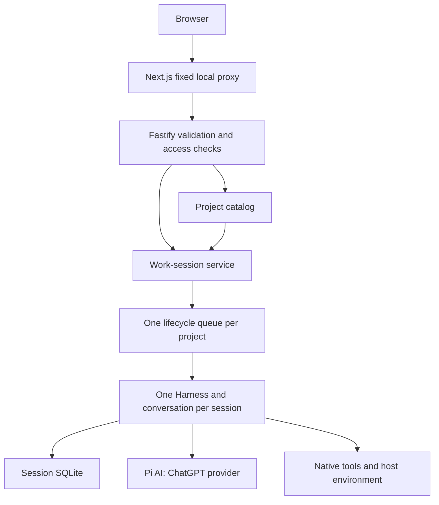

# Console architecture

Console has a Next.js client and a Fastify backend. The MVP connects to one local backend.
Console owns project/session lifecycle; Pi Durable owns conversation records and execution.

## Request and ownership path



```text
Backend process
 └─ Project: existing canonical directory
     ├─ Work session A: Harness + SQLite + one conversation
     └─ Work session B: Harness + SQLite + one conversation
```

Only one session may execute per project. A session with unfinished/interrupted work retains the
project's execution claim. An unavailable sibling also blocks execution, rather than assuming idle.
Different projects may run independently; neither projects nor Harnesses provide OS isolation.

## Responsibility boundaries

| Owner | Responsibility |
| --- | --- |
| HTTP routes | Access checks, JSON schemas, status codes and response shaping |
| Project catalog | Register existing canonical directories, list and rename |
| Session service | Durable identities, project execution rule, lifecycle queue, deletion and recovery |
| Runtime adapter | Assemble Pi, configure/submit/cancel/resume and project history/live snapshots |
| Pi Durable | Built-in tasks, inbox, transcript, documents, atomic commits and replay policies |
| Pi AI | Model metadata, provider authentication and inference |
| NodeExecutionEnv | Native host file and shell operations |

HTTP handlers call application services. The same project queue owns admission, settings,
cancellation, recovery and deletion. State is checked again inside the queue, including for
requests that obtained a session reference before deletion. Long agent execution does not hold
the application queue: Pi owns it, and the service checks Pi's actual task state.

## Lifecycle and recovery

- Input is accepted only while its session is idle and every sibling is idle.
- Retrying an admitted request returns its original identity before checking idle state. Different
  text with that request ID returns 409.
- Opening a Harness reconciles saved state but does not start scheduling. New input cannot resume
  unfinished work. Resume starts only that session's scheduler; other sessions have other Harnesses.
- Cancel joins Pi cancellation. It never invokes another session's scheduler.
- Runtime reports log fixed categories and IDs, never arbitrary provider exception payloads.
- A failed Harness is exposed as unavailable. Explicit Resume closes the failed instance and reopens
  storage before scheduling. Damaged storage can still fail recovery and must not be treated as idle.
- Deletion requires an idle Harness, closes it, writes a catalog tombstone, then removes its owned
  directory. DELETE retries finish interrupted cleanup. Creation retries cannot resurrect tombstones.

A stored submission is not an exactly-once guarantee for shell commands or external services.
Graceful reopen and SIGKILL recovery are exercised; power-loss and arbitrary effect replay are not certified.

## Storage

| Path below the data directory (default ~/.local/share/console) | Contents |
| --- | --- |
| `credentials.sqlite` | Pi credentials and installation identity; existing credentials retained |
| `mvp/catalog.sqlite` | Projects, sessions and deletion/creation tombstones |
| `mvp/sessions/<uuid>/conversation.sqlite` | Pi transcript, configuration, tasks and built-in documents |

The fresh `mvp` namespace does not import earlier experimental layouts. Old catalogs, histories
and web connection files are left untouched. Deleting a session never removes its project directory.
One backend process owns a data directory, enforced by the credential database's exclusive lock.

Pi packages remain pinned to 1.4.0. The existing declaration patch and dependency extension remain;
this scope reduction does not also upgrade the runtime. Review upgrades against the installed API.

## Execution and client boundary

Only CodingTools (`read`, `write`, `edit`, `bash`) is installed. No Console coordination or resource
extension is loaded. Tools use the registered project directory and inherit host authority.
The working directory is not a sandbox. Additional worktrees and managed environment policies are deferred.

The browser polls saved/live JSON and paged history. Stable pending input identities survive a tab
reload in sessionStorage; retries are explicit. Closing a client does not cancel admitted work.
The web proxy uses the fixed local backend origin without environment configuration. There is no
machine registry or remote web login. Remote provisioning and execution migration are outside this MVP.

The feature inventory owns capability status. Decision records describe historical designs and may
reference removed functionality; this document describes the current structure.
