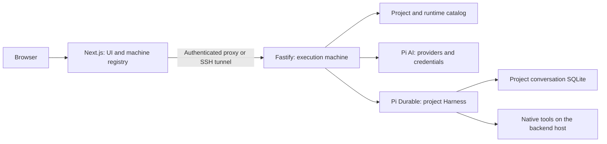

# Console architecture

Console has two application processes: a Next.js web client/server and a Fastify execution
backend. Pi Durable owns the agent runtime; Console supplies product metadata, HTTP operations
and browser projections. [Requirements](requirements.md) owns product intent;
[features](features.md) is the single implementation checklist. Package guides own setup,
source maps and API details: [server](packages/server.md), [web](packages/web.md).

## System boundary



The browser does not own execution. Closing a tab or disconnecting a saved machine connection
leaves the backend running. The web server can manage connections without an execution backend.
There is no team login, remote web-access login, PWA or application-wide command palette in this
checkout. Connecting to a remote execution backend is distinct from exposing the web app remotely.

## Product hierarchy

```text
Machine
 └─ Project: existing directory, created directory or public GitHub clone
     └─ One hidden session: Harness + SQLite + scheduler
         ├─ Main/independent conversation
         ├─ Fork conversation
         └─ Task-owned subagent conversation
             └─ Runtime tasks: generation, tools, compaction and delegation
```

The UI creates conversations under projects; sessions are internal API/storage identities.
All conversations in a project share its files and explicit revisioned project memory, but have
separate histories and agent configuration. Transcripts are not merged automatically. Forks keep
native history ancestry; subagents have durable task ownership. Neither creates an isolated Git
checkout. A project runtime's scheduler and mutation queue are shared by its conversations.

## Component responsibilities

| Owner                             | Responsibility                                                                                            |
| --------------------------------- | --------------------------------------------------------------------------------------------------------- |
| Next.js web server                | Explicit connection registry, server-held backend tokens, bounded proxy and managed SSH forwarding        |
| React workspace                   | Navigation, local drafts, snapshot cache, transcript rendering and polling                                |
| Fastify HTTP layer                | Backend authentication, request validation, routes and safe error responses                               |
| Console model adapter             | Persistent Pi credential store and provider-login prompt/answer bridge                                    |
| Console project/catalog services  | Machine defaults, paths, clone lifecycle, names, runtime identities and Trash                             |
| Console runtime adapter           | Harness assembly, serialized mutations, request receipts, lifecycle controls and bounded read projections |
| Pi AI                             | Provider catalogs, supported authentication, model capabilities and inference                             |
| Pi Durable                        | Conversations, transcript, documents, tasks, inbox, compaction, forks and recovery primitives             |
| Pi CodingTools / NodeExecutionEnv | Native host file operations and shell execution                                                           |

Source-folder ownership and extension points live in the package guides rather than a second
file-by-file map here. One runtime has one queue and one Harness; splitting source files must
not introduce competing mutation queues.

## First Pi integration

Pi packages are pinned to 1.4.0 in the server manifest. The workspace patch supplies missing
JSON import attributes in Pi AI declarations, and a package extension supplies the MCP SDK
referenced by published Google declarations. Reviewed Google/protobuf install scripts are
disabled in workspace configuration. Reassess these workarounds when upgrading dependencies.

Provider setup adapts Pi's notifications, prompts, cancellation, logout and catalog refresh.
Credentials are stored through Pi's credential-store interface. A SQLite ownership lock prevents
concurrent backend processes from refreshing the same store. Connected-provider status confirms
configuration, not model entitlement or successful inference.

Configuration validates model/thinking support and writes Pi agent state while idle. Unfinished
work rejects configuration changes. Console does not maintain an independent provider catalog.

### Input and recovery

1. The browser selects a machine, project and conversation.
2. Model/thinking changes remain local until Send. Changed configuration is confirmed before
   message admission; these are sequential requests, not one atomic transaction.
3. The browser submits text with a stable request ID and delivery mode. An uncertain retry retains
   its identity; it must not reuse that ID for different input or reconfigure admitted running work.
4. The runtime serializes mutations, admits input through Pi, and exposes saved/live projections.
5. Polling updates the selected conversation. Reopening reads existing work without resubmitting it.

Pi request deduplication is not a general exactly-once guarantee for external effects. Tool replay
follows its policy; interrupted writes or commands must not be assumed safe to repeat. Backend
restart opens stored work without scheduling it: Resume explicitly starts the project scheduler.
New input cannot silently resume interrupted work. Cancel persists its outcome. Fork cancellation
is independent; cancellation of a parent reaches its task-owned delegated work.

Compaction/reset, queued withdrawal and project-memory updates retain their operation identities
or receipts. Plans are agent-reported progress in a rewindable conversation document, not proof
that tests passed. Full-output artifacts, arbitrary history search, durable approval jobs and
background-agent messaging remain separate integrations in the feature inventory.

## Storage and ownership

| Store                                           | Owner and contents                                                                     |
| ----------------------------------------------- | -------------------------------------------------------------------------------------- |
| `$XDG_DATA_HOME/console-web/connections.sqlite` | Web server: explicit machine connections, tokens, menu preferences and recent metadata |
| Backend `credentials.sqlite`                    | Pi credentials and installation identity                                               |
| Backend `catalog.sqlite`                        | Projects, runtime catalog and machine settings                                         |
| Backend `sessions/<uuid>/conversation.sqlite`   | Pi-owned transcript, agent state, inbox, tasks and Console runtime documents           |

Defaults fall back to `~/.local/share/console-web` and `~/.local/share/console`.
`CONSOLE_DATA_DIR` selects an absolute backend data directory; changing it selects another
storage set and does not move existing data. Run one backend per data directory. Saved secrets
are private-permission SQLite data, not an encrypted vault. Production backup/restore and retention
are not implemented. Runtime identities and document kinds must remain stable during refactors.

Experimental multi-session histories were reset by maintainer decision when adopting one runtime
per project; no legacy import or compatibility migration is provided.

## Machine and project lifecycle

The web registry starts empty. An explicit connection validates the backend's product, API and
stable machine identity before registration. It restores only a valid saved selection; it does
not enroll a local server or fall back to another machine. The explicit local-server check only
fills the connection form. Backend tokens remain server-side after registration.

The proxy accepts HTTPS or loopback HTTP, rejects redirects and bounds traffic. Remote backend
connections require a token; managed SSH uses existing trusted keys to reach an already-running
server. It does not install or provision Console. Disconnect clears tokens and closes its tunnel,
retaining recent metadata without deleting backend data. The implicit `/api/v1/*` proxy returns
410; the retired backend hub is not another connection owner.

Machine defaults include a readable name, project directory and remembered model choices.
Projects register existing directories, explicitly create directories or clone public HTTPS
GitHub repositories. Clone uses a temporary destination and excludes credential helpers, hooks
and setup scripts. Project association supplies a working directory, not tool confinement.

Trash retains source and history for restoration. Permanent deletion requires idle ownership and
explicit confirmation. The per-conversation purge adapter closes the Harness and checks the
pinned Pi storage version before removing an eligible leaf; ancestry/task-owned records have
additional restrictions. Purging a project never removes its source directory. This is logical
application deletion, not physical erasure of backups. API details belong in the server guide.

## Direct host execution

`runtime/session.ts` installs native CodingTools, project resources and Console coordination.
`Harness.open` receives a per-conversation `NodeExecutionEnv` rooted at the project path.
Native `read`, `write`, `edit` and `bash` use the backend account's filesystem, network and
inherited environment authority. Tool selection is not an OS security boundary.

The maintainer removed nono, worker supervision, access presets and policy APIs. Console no
longer adds disposable homes, credential separation, private-path exclusions, command deadlines
or scratch cleanup. Native Pi owns cancellation, replay policies and output handling.

Backend bearer authentication and the mutation request header protect HTTP operations; CORS is
not enabled. They do not confine tools or provide multiple-user permissions. The web registry's
local access restriction is not a complete remote web-authentication system.

## Pi compatibility and resource boundary

Console targets equivalent product features on its Durable runtime. Unchanged Pi CLI plugins,
configuration files and terminal widgets are not required compatibility targets. Pi AI supplies
model services; Durable supplies runtime primitives; applications such as Durable Pi or Pi Pocket
add their own product integrations. Installing the runtime does not install those products' features.

The Markdown resource adapter reads bounded instructions, skills and templates inside the project,
skips symlinks and does not scan ancestors or personal-home resources. SYSTEM/APPEND_SYSTEM add
scoped prompt sections. Resource discovery executes no plugin code; indexing limits do not confine
native tools. Executable extensions, MCP and Code Mode need their own integration/trust designs.

## Client state and presentation

The persistent shell retains chat across same-machine management routes. Machine changes remount
its client state. Text/model drafts and uncertain send identities are per conversation while the
workspace is mounted; a reload discards them. Other editors retain explicit Save actions.

A bounded 20-conversation snapshot cache coordinates selection. Warm visits show cached data;
cold visits retain the prior conversation until the new identity, URL and snapshot can commit
together. Late/aborted responses cannot replace a newer selection. Cached status is provisional;
backend mutation validation remains authoritative. Older history and disclosure/scroll state are
not preserved across conversation component changes.

Transcript projection pairs calls/results by native IDs and preserves orphaned results until
older history joins them. Missing output is not success. Markdown disables raw HTML and automatic
remote images; activity/output disclosures remain inspectable and pause bottom-following.
Provider-qualified model choices and thinking tiers come from the backend, with no fabricated
catalog rows. Detailed UI behavior and known catalog limits live in the web guide.

## Decision history and maintenance

[Decision records](decisions/) preserve earlier reasoning. Some describe superseded session,
hub and sandbox designs; this document and the package guides describe the current implementation.
Use Git history for retired audits and old verification diaries. Keep feature status in
[features](features.md), product decisions in requirements, and test outcomes in the relevant
change/PR rather than appending another chronological report to each guide.
