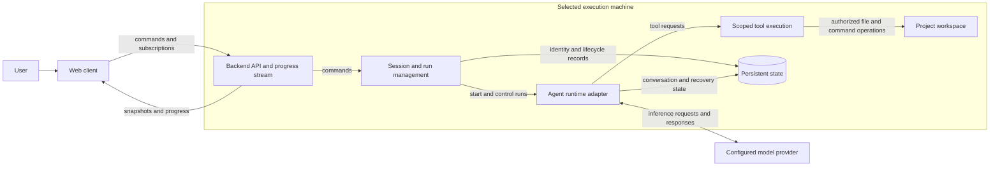

# Console architecture

Status: Pi Durable sessions, providers, projects, forks, subagents and runtime inspection are implemented. Native coding tools now use direct host execution; nono, access policies and restricted workers have been removed at the maintainer's request.

[Requirements](requirements.md) owns product outcomes and scope. This document owns responsibilities,
state, interfaces, and technical tradeoffs. It must distinguish intended design from verified implementation.

## Intended system boundary

Begin with one backend on the machine containing the project workspace and a browser client.
The backend owns execution and saved state. The browser is a view and control surface, not the
owner of the running agent. This separation supports REQ-1 through REQ-5.

The current browser app is served by Next.js. Its health request is forwarded to Fastify
through a Next.js rewrite. These are two local Node.js processes; `mise run dev` starts
both directly on the host. The Next.js process does not own agent execution or persistent sessions.

The machine boundary shows where work and storage belong; it does not require separate services
for each box. The first backend can be one process. Model inference may be remote even when the
backend runs locally; relevant task content and tool results may be sent to that provider.

## Component responsibilities

- **Web client:** workspace/session navigation, task input, progress, errors, and explicit controls.
  It reconnects using stable identities rather than recreating work.
- **Backend API:** validate client requests, expose saved state, and deliver progress. HTTP and an
  event stream are the proposed interface shape; exact routes, payloads, and transport are unresolved.
- **Session/run management:** create identities, bind sessions to approved workspaces, track run
  lifecycle, coordinate limits, and distinguish terminal results from client connectivity.
- **Runtime adapter:** integrate the selected harness without exposing its storage internals to
  clients. Map its events, controls, and recovery behavior into Console's documented contracts.
- **Tool execution:** operate in the selected workspace under configured authority. Concurrent
  code-writing tasks need separate checkouts; a conversation fork is not filesystem isolation.
- **Persistent state:** retain Console metadata and required runtime state. These may be separate
  stores owned by Console and the harness; no shared database schema has been chosen.

## Source organization

The existing packages remain one backend and one web application; folders are ownership boundaries,
not new services. Entrypoints stay stable. The initial source reorganization preserved contracts; the subsequent
adapter cleanup intentionally retired the old backend hub and duplicate coding-tool names.
Database locations and document identities remain stable; removed policy records are not migrated.

- Server: `http` composes routes; `models`, `platform` and `projects` own their
  domain services; `sessions` owns catalog/lifecycle routes; `runtime` owns the Harness,
  configuration, input admission and read projections; `projects/context.ts` owns Markdown resource integration.
- Web: App Router entries compose domain components. `chat` separates data/requests from layout;
  `details`, `navigation`, `machines`, `models`, `projects` and `layout` own their respective UI.
  `shared` contains reusable form controls and `ui` retains shadcn primitives. Pure transcript
  transformations live in `lib/chat`; server-only connection/SSH code lives in `lib/server`.
- One session still owns one mutation queue and Harness. Splitting runtime operations into modules
  must not create parallel queues or change the order of permission, retry or recovery checks.
- Source moves must update module paths, fixtures and evidence links. Verify both source and compiled runtime behavior.

Navigation requests session summaries with optional bundled conversations, avoiding one HTTP
request per session on updated servers. The old session response and conversation endpoints remain
available. Session listing reads project membership once; conversation listing shares one runtime
task inspection across its summaries. These read optimizations do not cache execution state or
change durable mutations. Hidden detail panels suspend their reads without unmounting drafts;
active transcript polling remains independent.

See the [server guide](packages/server.md#structure-and-extension) and
[web guide](packages/web.md#structure-and-boundaries) for the current source map. Prefer direct
imports from owning modules to compatibility wrappers or a new generic service framework.

## Logical data model

- A backend identifies an execution machine and its capabilities.
- A workspace associates that backend with an approved project directory.
- A session has a stable identity, readable name, workspace, and conversations.
- A conversation retains messages and tool interactions; native forks record history ancestry and delegated children retain task ownership.
- A run records an assignment, lifecycle, applicable limits, result, and verification references.
- Later approval records bind a decision to an exact action or artifact, not a reusable blanket permission.

Names aid navigation; stable identities support reopening and request correlation. Entity boundaries,
schemas, event ordering, retention, and compatibility must be settled before implementing their APIs.

## Main flow

1. The client selects a backend and existing workspace and requests a named session.
2. The backend validates the workspace, creates stable identities, and establishes persistent state.
3. A submitted assignment starts a bounded run through the runtime adapter.
4. Runtime and tool activity are recorded and exposed to the client.
5. Disconnecting removes the client connection, not ownership of the run. Reconnection retrieves a
   saved snapshot and the required subsequent activity without resubmitting the assignment.
6. Completion leaves the session available. Cancellation and later archiving/deletion use distinct operations.

Request identity and progress catch-up semantics require explicit design before concurrent clients
or retrying submissions are supported. Do not infer exactly-once execution from this flow.

## Recovery and ownership rules

- A backend process must own a run's execution; multiple clients must not become competing runners.
- Backend restart can recover work only if the selected runtime supports the agreed recovery contract
  and required storage is available. Session history alone does not establish execution recovery.
- Explicit cancellation must survive recovery. An uncertain external effect needs reconciliation or
  an operation identity before a retry can be considered safe.
- Store persistent state and required workspace files independently of disposable runtime instances.
- A worktree isolates source changes, not credentials, network access, ports, or shared databases.
- Client requests, issue text, and tool output do not grant additional execution permissions.

These are intended constraints requiring implementation and proof, not currently enforced guarantees.

## Technology and layout candidates

- **Node.js foundation (configured):** mise provides Node.js (`lts`), pnpm (`latest`), and Biome (`latest`);
  `pnpm-workspace.yaml` discovers packages under `packages/*`. The private root package exposes shared check commands.
  Biome checks JavaScript, TypeScript, JSON, CSS, and GraphQL through pnpm, prek, and CI; RumDL handles Markdown.
  The server uses TypeScript and Fastify in one Node.js process. Its health endpoint, build, type checks,
  and HTTP tests are implemented; see the [server guide](packages/server.md).
- **Web foundation (configured):** Next.js App Router, React, TypeScript, Tailwind CSS, and shadcn/ui provide the browser
  starter. It checks the Fastify health endpoint through a web-origin proxy; see the [web guide](packages/web.md).
  The conversation dashboard and provider settings are implemented; Console user authentication and shared-session controls are not.
  shadcn preset `bddBUJXM` supplies the initial theme, Geist font, and Lucide icon choice.
- **Pi Durable (integrated):** pinned to 1.4.0 for isolated session conversations with native host tools. Provider authentication and model access use Pi AI. See the integration section below for tested and outstanding behavior.
- **SQLite (integrated):** separate databases hold Console credentials, the session catalog, and per-session Pi-owned conversation state. The first version has no backup or retention workflow; ownership and restart behavior are described below.
- **Monorepo:** `packages/server/` is a private workspace package containing the HTTP server scaffold.
  `packages/web/` is a private Next.js workspace package. These boundaries do not require
  independent microservice deployments.
- **Remote hosting:** a Kubernetes machine was discussed as a later host. It is not required for
  the first local workflow. A central hub, extra clients, and an automation scheduler are not initial components.

Entries marked configured or created describe the repository foundation. Remaining candidates should
not be treated as approved implementation choices solely because they appear here.
The video's Google Cloud, FastAPI, ADK, PostgreSQL, and model choices belong to its example, not Console.

## Developing Console versus Console's runtime

The existing user-level refine-issue and issue-to-pr skills support development of this repository.
They are not shipped Console features and are not required external context sources for understanding
these documents. GitHub issues/PRs track delivery; source and these documents retain durable knowledge.

Future issue, schedule, or event triggers would dispatch through the backend's existing assignment
path. Trigger configuration, deduplication, authority, and approvals need their own concrete designs.

## Implementation evidence and maintenance

Start by selecting one local end-to-end proof from [requirements](requirements.md#acceptance-scenarios-to-refine-into-issues).
Verify the chosen model access and runtime behavior before expanding the product.

Update this document when a change affects ownership, interfaces, storage, lifecycle, or deployment.
Record what is implemented separately from intended design, and replace candidates with the actual
decision and its reasoning when agreed. Keep feature tasks and verification results in their issues/PRs.

## First Pi integration

The [integration decision](decisions/0001-local-pi-integration.md) records provider boundaries. The [session decision](decisions/0002-session-owned-harnesses.md) records isolation, configuration, and preservation of existing data.

- Next.js owns the browser application and the independent machine registry/proxy. `/api/machines` manages explicit connections; `/api/machines/:id/api/*` forwards allowlisted requests with server-held credentials. Nothing enrolls or selects a local backend automatically. The prior backend hub API has been removed; the web registry is the sole connection path. Machine identity/settings remain on each Fastify backend; see the connection section below.
- `src/http/console.ts` registers validated routes, closes resources, and rejects browser mutations without the Console request header. No CORS or Console user authentication is configured. This is for private loopback use only.
- `src/models/providers.ts` adapts Pi's built-in catalog, login prompts, notifications, cancellation, logout, and explicit model-catalog refresh. Environment-only providers show setup guidance. Provider discovery does not prove access to a model.
- `src/models/credentials.ts` supplies Pi's credential-store interface. Credentials and installation identity live in `credentials.sqlite`; Pi owns login and token refresh. An exclusive SQLite lock prevents two backend processes from rotating the same credentials.
- `src/sessions/catalog.ts` owns a SQLite catalog and one cached harness per session. New sessions store Pi state under `sessions/<uuid>/conversation.sqlite`; an existing root `conversation.sqlite` is registered as the `default` session without moving it. A session that cannot open is listed as unavailable while other sessions remain usable.
- `src/runtime/session.ts` owns each harness and root conversation. CodingTools and the project resource extension are registered directly, with native tools selected initially. Configuration, submission, cancellation, and resume are serialized within each session. Conversations run independently; each conversation can accept steering and queued follow-ups during its run.
- `src/sessions/routes.ts` exposes session creation, snapshots, saved configuration, and lifecycle commands. Creation request IDs deduplicate retries; message request IDs are scoped to their session.
- Provider responses include supported thinking levels from Pi's `getSupportedThinkingLevels()` and model context capacity. Saving settings validates the selected model/level against the installed catalog and persists them in Pi's `pi.agent` document. Settings changes during unfinished work return 409. Messages use saved settings instead of carrying a second configuration.
- Browser polling retrieves the latest 50 transcript entries, committed partial text, and lifecycle state. The browser never owns the run. Session list polling runs every two seconds; selected transcript polling runs every second. A URL query remembers selection on reload, and in-memory drafts and uncertain submission IDs remain separate per conversation while the page is open. Repeated submissions with the same request ID return the original admission, including after restart. A request ID identifies its original input and must not be reused for different content or delivery mode.
- Closing the browser leaves execution running. Backend restart opens saved work without scheduling it; Resume explicitly enables scheduling. Cancel aborts the conversation and persists that outcome. Read/list tools may replay; file writes and HTTP GET do not replay automatically after interruption. Other external-effect workflows remain unimplemented.

Storage defaults to `$XDG_DATA_HOME/console` or `~/.local/share/console`. `CONSOLE_DATA_DIR` overrides it. The directory is owner-only and saved credentials are plaintext SQLite with owner-only permissions, not an encrypted vault. Keep it outside source control and run one backend per data directory. No automatic retention, export, or backup mechanism exists yet. Login attempts are ephemeral, expire after ten minutes, and can be reattached after a page reload while the backend remains alive.

Pi packages are pinned to 1.4.0. A pnpm patch adds missing JSON import attributes to Pi AI's published declarations, preserving strict NodeNext checking. A package extension supplies the MCP SDK referenced by Google's published declarations. Reviewed Google/protobuf lifecycle scripts are explicitly disabled; neither is required for these installed SDKs to run. Revisit these workarounds on upgrades.

## Direct host execution

`runtime/session.ts` installs Pi's `CodingTools` in a registry and opens `Harness` with
`env: target => new NodeExecutionEnv({cwd: target.cwd ?? projectPath})`. SQLite storage preserves
Pi conversations, documents, inboxes and tasks. Console supplies HTTP routing, provider setup,
project/session metadata, input identity, read projections and optional coordination/resources.

Native `read`, `write`, `edit` and `bash` run directly with the backend account's filesystem,
network and inherited environment authority. The working directory is not confinement. Tool
selection controls what the model is offered; it is not an OS security boundary. There is no
nono executable, policy document, subprocess bridge, grant API or sandbox editor in this path.
Existing database records are retained without translating old tool/extension names or tasks.

The earlier [worker decision](decisions/0003-configurable-nono-workers.md) and
[native-tool decision](decisions/0009-native-pi-tools-in-nono.md) describe superseded designs.
Native Pi owns shell cancellation, replay policies and tool output handling; Console no longer
adds disposable homes, private-path exclusions, fixed command deadlines or scratch cleanup.

## Backend and workspace configuration

The Next.js web server owns `$XDG_DATA_HOME/console-web/connections.sqlite` (default
`~/.local/share/console-web/connections.sqlite`) independently of any running execution backend.
The registry starts empty. The user enters an origin, optional label, and access token when needed.
An authenticated `GET /v1/connection-info` checks product, API version, and persistent machine
identity before registration. The browser receives safe connection metadata, never saved tokens.

No automatic scanning, synthetic local record, or fallback selection occurs. The explicit
Check local server button probes only loopback port 3000 and fills the connection form; it never enrolls a machine.
Saved explicit connections survive web-server restarts; only a valid saved selection is reopened.
Disconnect deactivates that registry entry, clears its token, closes its managed SSH tunnel, and
stops browser polling. Recent metadata remains until explicitly forgotten; it does not stop
backend execution or erase projects, provider credentials, or history. A stale tab cannot continue
proxying through a disconnected connection. The web UI and registry remain available with no backend.

The web proxy requires HTTPS or a loopback HTTP origin (including an operator-managed SSH tunnel),
rejects redirects and non-Console resources, and bounds requests/responses. Remote connections need
an access token; a loopback backend without configured token authentication accepts an empty field.
These are trusted operator connections, not team accounts. The old implicit `/api/v1/*` web proxy
returns 410. The backend's legacy `/backends` routes have been removed. Existing `backends.sqlite`
files are left untouched, without an import into the web registry.
`catalog.sqlite` stores projects as workspace identities with canonical directory paths. A project
may register an existing directory or explicitly create one under an existing parent. Registration
does not enable agent tools. New sessions may bind to a workspace; legacy unbound sessions remain
valid. Session and project names are editable without moving directories or databases.

Every session still owns one Pi Harness and SQLite database. Its conversations now use Pi's own
`createConversation()` API, with name/request identity stored atomically in `console.conversation`.
New conversations inherit the main conversation's model and working directory, then retain independent
settings, transcript, inputs, and cancellation. Requests use `/sessions/:id/conversations/:conversationId`.
The legacy session endpoints address Main when active, otherwise the first active conversation. Workspace filesystem edits
are shared; separate conversations do not create filesystem isolation. Pi scheduling is session-wide:
Resume starts the session scheduler. New input cannot implicitly resume other interrupted work.

## Machine and project lifecycle

`platform/machine-settings.ts` persists the name, default clone directory (`~/Projects` initially), fixed
model default, and last selected configuration in `catalog.sqlite`. Pi is a backend dependency;
there is no separate Pi CLI installation step. Git availability is reported for repository cloning.
New sessions prefer the project's last model configuration, then a fixed machine default, then
the machine's last configuration. Existing connected configurations seed the remembered default
when upgrading. Unavailable saved models require an explicit selection, not a silent substitute.

Public HTTPS GitHub URLs can be cloned under the machine's project directory, with an optional
absolute override. `projects/workspaces.ts` tracks cloning, ready, failed, and interrupted states. Clone
uses Git without user credential helpers, hooks, templates, or file/ext transports; it writes to
a temporary sibling and publishes the directory after success. Failed clones can be retried.
Registration/cloning never runs repository setup scripts or grants agent tools.

New conversations select native coding tools and start in the project directory.
Commands use Pi's host environment, including installed tools and ordinary network access.
No Console resource quota or project confinement is applied.

Deleting an idle session or conversation marks it as Trash. Deleting a project hides its sessions;
restore the project before restoring individual sessions. Moving to Trash removes neither project files nor conversation databases. The last active conversation cannot be deleted separately; delete its session instead.

Home (`/`) shows actual machine counts and selected-machine summaries. `/chat` provides machine
selection, project/conversation navigation, conversation controls, and shadcn Resizable panels. All routes
share the application header. Machine selection remains scoped to the browser tab.

## Network and agent inspection

The conversation surface has one collapsible/resizable Machines tree and on-demand agent controls.
The tree loads registered machines through the web-owned registry and scoped proxy, grouping
projects, sessions, root conversations, forks, and task-owned children. Pi's immutable conversation
IDs supply agent numbers; session numbers use catalog row identities. Naming is optional on
creation and editable afterward. Trash does not recycle these identities.

The details panel separates Conversation, Project and Machine scope and reads actual runtime data. Tools
come from Pi's installed registry with schemas, descriptions, and replay policies; selection cannot
include tools outside the installed registry. Extension checkboxes select actual Pi extensions, including their prompt sections and hooks.
Tools execute with host authority. They do not install arbitrary code. Child agents
and new conversations inherit the actual extension selection. Instructions are saved separately.
Tasks lists live Pi model/tool tasks, not a catalog of example jobs.

`console.agent` supplies `read_state`, `update_state`, and explicit `subagent` delegation. New
sessions select coordination and native coding tools. Existing
conversations keep their saved selection until explicitly changed. Machine-wide JSON lives in
`agent-state.sqlite`; compare-and-swap revisions reject stale full-object saves. Tool updates use
session/task receipts committed in the same SQLite transaction so replay cannot apply them twice.
State is shared across projects on the machine and must not contain credentials.

The subagent tool creates a Pi conversation owned by its durable tool task in one commit, reuses
it on replay, and submits with a stable request ID. It inherits the parent's model, instructions,
and working directory; recursive delegation is excluded. Parent cancellation reaches owned work.
Forks use Pi's native `fork(entryId)` API, preserve history ancestry and agent configuration,
and remain independent of their parent's cancellation. Both share project files. Neither operation
creates a Git worktree. Conversation inspection exposes parent identity from Pi records.

Slash commands open inspector panels, create numbered agents/sessions, or invoke existing
cancel/resume endpoints. They execute locally as UI actions rather than being sent as prompts.
Custom hook installation/editing, example durable-job workflows, and arbitrary plugin loading
are not implemented. See [ADR 0006](decisions/0006-network-and-agent-controls.md).

## Permanent deletion and direct chat controls

Trash exposes a second, explicit confirmation for permanent deletion. A trashed session's harness
must be idle and closed before removing its Pi database and catalog record. Legacy Main's database
is removed individually; machine credentials, shared state, connection registry, and source files
are retained. Session labels use a persistent counter so deletion never reuses a number.

Pi 1.4 has no public per-conversation deletion API. `runtime/purge.ts` is a maintenance adapter
for that pinned storage schema, called only after closing the idle harness. It removes a trashed
leaf's entries, submissions, tasks, document revisions, documents, and conversation record in one
transaction, retaining minted-ID history. It refuses a different pinned Pi version pending review.
Fork descendants must be erased first. Main and task-owned children are erased through their session,
preventing dangling runtime ownership. This is logical application deletion, not a guarantee that
backups or every physical storage copy are erased. Project registration can be purged after its
sessions are permanently deleted; project source directories remain untouched.

Machine-tree rows use shadcn context menus and trailing ellipsis menus. Hover/focus replaces
trailing metadata with a square button in normal layout, keeping actions clear of labels.
Trash actions require inline confirmation. Rename edits its label; Enter/blur saves and Escape cancels. The remembered machine tree
is the sole permanent side column; details open as a resizable desktop split or narrow-screen overlay.
The composer uses shadcn Popover for a model list and discrete supported-thinking slider;
selections update the selected conversation immediately. The Tools panel explains empty selection
and provides explicit coordination/tool-permission setup actions.

## Settings and transport ownership

The header owns Home, Chat, and Settings. Machine selection and session creation are contextual
workspace actions, not global header controls. Connect a machine opens `/machines` in the main
display, with connection/disconnection and recent history outside Settings. `/settings` is a full
page with separate Model choices, Machine defaults, and Providers sections. Credentials and machine
defaults belong to the selected execution machine; model/thinking menu preferences belong to the
web server. Model preferences filter menus only, never change running or saved agents. Empty
preferences offer only the current model until the user selects more models in Settings.

Chat permanently reserves space only for the machine tree and conversation. The tree heading is
Machines. Each machine has a Projects section with a plus button opening a shadcn Dialog
for an existing folder, new folder, or public GitHub clone. Conversation rows sit directly under
their project; a project-row plus creates and opens one directly, with no access-selection dialog.
Tool permissions remain conversation controls. Internal session containers and the initial Main label
are hidden. Forks and children
stay nested, with distinct fork/delegation icons and aligned disclosure slots. Expandable rows
toggle from their name or chevron; conversation rows also select their conversation. Browser-local
expansion choices use stable connection/project/session/conversation IDs and survive reloads and
renames. Saved collapse choices are not overridden by selection or polling. Projects is collapsible
without introducing another indentation level.
Machine menus route to machine-scoped Settings. The on-demand details panel explicitly selects
Conversation, Project or Machine scope. Conversation has Overview, Activity, Access and Instructions;
shared state belongs to Machine, and project metadata belongs to Project. Overview folds usage/context
controls; Access folds tool selection; Instructions folds resources/extensions. Reported plans and
runtime tasks are distinct. Closing preserves mounted drafts and returns focus. The desktop split
resizes the conversation and restores its space when closed; narrow screens use an overlay. Tree collapse is
explicit, remembered per browser tab, and its button has no persistent selected background.
Deletion remains recoverable through Trash, with explicit permanent deletion and confirmation.

Managed SSH runs on the web server host using system OpenSSH, existing configuration/keys/agent,
strict known-host verification, and loopback-only forwarding. It does not install or launch remote
Console servers, collect SSH passwords, or weaken backend bearer authentication. Direct remote
HTTP remains prohibited; HTTPS still requires a token. Disconnect clears tokens and closes owned
tunnels. Reconnect is explicit, revalidates API identity, and asks for any required token again.
Only localhost port 3000 can be checked through the explicit local probe; there is no LAN discovery.

### Official Pi Durable example review

Reviewed official upstream revision `a87b742ff4ce262c07b7830a25c73c1442dab41b`:
[Harness](https://github.com/earendil-works/pi/blob/a87b742ff4ce262c07b7830a25c73c1442dab41b/packages/durable/test/examples/05-harness.ts),
[recovery](https://github.com/earendil-works/pi/blob/a87b742ff4ce262c07b7830a25c73c1442dab41b/packages/durable/test/examples/12-recovery.ts),
[owned subagents](https://github.com/earendil-works/pi/blob/a87b742ff4ce262c07b7830a25c73c1442dab41b/packages/durable/test/examples/21-subagent-foreground.ts),
[per-conversation sandbox](https://github.com/earendil-works/pi/blob/a87b742ff4ce262c07b7830a25c73c1442dab41b/packages/durable/test/examples/28-sandbox-per-conversation.ts),
and extension reload/restart and durable views examples.

Pi owns persisted agent choices, conversations, task ownership, submissions, and recovery. Extension
code must be registered again when reopening storage; durable records store names, not executable
code. Console follows that registry/Harness boundary and uses owned child conversations and stable
request IDs for delegation. Existing tests verify restart, explicit resume, cancellation, forks,
subagents, and real native tool invocation without paid inference. These examples do not supply
machine discovery, SSH transport, browser settings, or host execution policy: Console owns
those layers. Console keeps pinned Pi 1.4.0; newer upstream examples are design references, not
proof that newer APIs are available. Hot extension replacement, custom durable jobs, and a Chord
reactive-view migration remain unimplemented. Real remote SSH and macOS isolation are unverified.

## Paged conversation history

Snapshots read the newest 50 entries through Pi's native fork-aware history API. Older pages use
an exclusive entry-ID bound on a separate history endpoint; they do not expand the snapshot or
scan the entire transcript. The web client loads earlier pages only on upward scroll or explicit
request, merges stable message IDs with polling updates, and anchors the visible message during
prepend. Opening a conversation positions the view at its latest output. Scrolling away from the
bottom suspends automatic following until the user returns there. History requests are aborted
when their conversation component unmounts.

## Default project ownership

Each machine persists a protected Default project for conversations created without a project.
Its directory is `<dataDirectory>-projects/default`. New session records reference a project;
the runtime sets AgentDoc.cwd to that directory. Project association organizes work and sets
its starting directory, without constraining filesystem access. Session databases and project
files remain distinct; machine-wide state is still shared across projects.

## Pi coding execution boundary

Native Pi coding tools execute through `NodeExecutionEnv` directly. They use the same host
account and environment as the backend. `host-runtime.test.ts` verifies native read/write/edit/bash,
project cwd, access outside the project, cancellation and persisted history on reopening.

Project, conversation and machine controls retain explicit scope navigation. Shared machine
state is not presented as conversation state; project metadata contains no conversation tabs.

## Runtime controls and project resources

Console now admits Pi steers/follow-ups during active work while retaining reject-if-busy for API
compatibility. It projects the persisted inbox, usage ledger, context estimate, live compactions,
tool calls and task dependencies. Withdrawal is scoped to the addressed conversation. Manual
compaction uses a native CompactionTask plus a receipt in one atomic Pi commit; reset uses a
request-identified native reset write. Neither action implicitly resumes an interrupted session.
Automatic compaction still uses Pi defaults. See the server guide for routes and replay semantics.

Project instructions, skill catalogs and prompt templates are read directly by the bounded
Markdown loader in Fastify. The project extension renders current root instructions
and exposes explicit nested-context/resource loading. The web inspector shows the loaded sources;
resource commands expand before durable input admission, after duplicate-request detection.
Markdown indexing limits do not confine native tools. Resource loading does not execute extensions. Workspace-root scope is intentional;
user resource directories, executable plugins, MCP and full CLI compatibility are separate adapters.
The user selected equivalent Console features on the existing Durable runtime. Remaining delivery
is tracked in the [Console feature inventory](features.md), without treating dependency APIs as completed UI.
[Pi integration scope](pi-capabilities.md) records compatibility and adapter boundaries.

## Readable transcript projection

The backend retains Pi's entries, tool-call IDs and error flags. The web's `lib/chat/transcript.ts` derives
message, context and activity blocks without changing storage. Calls/results pair by call ID, including
parallel calls that finish out of order. Results whose call is outside the loaded page remain visible;
loading earlier history joins them without dropping the output. Committed results override stale live
slots. Missing results remain unknown/interrupted, not successful.

The chat uses the existing shadcn Trace components following its AI Elements patterns. Activity and
individual outputs have separate disclosures, with bounded scrollable code/terminal output. Markdown
replies render through react-markdown/remark-gfm; raw HTML and automatic remote-image loading are disabled.
Disclosure choices remain while their rows are mounted. User inspection pauses bottom-following;
Jump to latest resumes it. Grouped message aliases preserve history anchors when earlier entries merge.

`console.plan` is a rewindable conversation document populated only by `update_plan`. Status is an
agent report, not proof of verification. Tool results retain historical updates; snapshots expose the
latest plan. Forks recover the plan at the selected entry and independent conversations start without
one. The web associates plans with their recorded activity rather than generating progress from prose.
