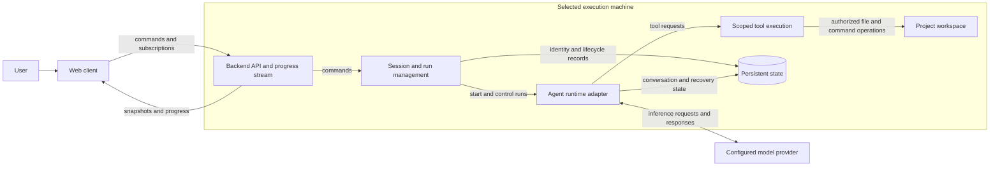

# Console architecture

Status: intended design for review; no application packages or runtime are implemented.

[Requirements](requirements.md) owns product outcomes and scope. This document owns responsibilities,
state, interfaces, and technical tradeoffs. It must distinguish intended design from verified implementation.

## Intended system boundary

Begin with one backend on the machine containing the project workspace and a browser client.
The backend owns execution and saved state. The browser is a view and control surface, not the
owner of the running agent. This separation supports REQ-1 through REQ-5.

The machine boundary shows where work and storage belong; it does not require separate services
for each box. The first backend can be one process. Model inference may be remote even when the
backend runs locally; relevant task content and tool results may be sent to that provider.

## Component responsibilities

- **Web client:** workspace/session navigation, task input, progress, errors, and explicit controls.
  It reconnects using stable identities rather than recreating work.
- **Backend API:** validate client requests, expose saved state, and deliver progress. HTTP and an
  event stream are the proposed interface shape; exact routes, payloads, and transport are unresolved.
- **Session/run management:** create identities, bind sessions to approved workspaces, track run
  lifecycle, coordinate limits, and distinguish terminal results from client connectivity.
- **Runtime adapter:** integrate the selected harness without exposing its storage internals to
  clients. Map its events, controls, and recovery behavior into Console's documented contracts.
- **Tool execution:** operate in the selected workspace under configured authority. Concurrent
  code-writing tasks need separate checkouts; a conversation fork is not filesystem isolation.
- **Persistent state:** retain Console metadata and required runtime state. These may be separate
  stores owned by Console and the harness; no shared database schema has been chosen.

## Logical data model

- A backend identifies an execution machine and its capabilities.
- A workspace associates that backend with an approved project directory.
- A session has a stable identity, readable name, workspace, and conversations.
- A conversation retains messages and tool interactions; branching is a later extension.
- A run records an assignment, lifecycle, applicable limits, result, and verification references.
- Later approval records bind a decision to an exact action or artifact, not a reusable blanket permission.

Names aid navigation; stable identities support reopening and request correlation. Entity boundaries,
schemas, event ordering, retention, and compatibility must be settled before implementing their APIs.

## Main flow

1. The client selects a backend and existing workspace and requests a named session.
2. The backend validates the workspace, creates stable identities, and establishes persistent state.
3. A submitted assignment starts a bounded run through the runtime adapter.
4. Runtime and tool activity are recorded and exposed to the client.
5. Disconnecting removes the client connection, not ownership of the run. Reconnection retrieves a
   saved snapshot and the required subsequent activity without resubmitting the assignment.
6. Completion leaves the session available. Cancellation and later archiving/deletion use distinct operations.

Request identity and progress catch-up semantics require explicit design before concurrent clients
or retrying submissions are supported. Do not infer exactly-once execution from this flow.

## Recovery and ownership rules

- A backend process must own a run's execution; multiple clients must not become competing runners.
- Backend restart can recover work only if the selected runtime supports the agreed recovery contract
  and required storage is available. Session history alone does not establish execution recovery.
- Explicit cancellation must survive recovery. An uncertain external effect needs reconciliation or
  an operation identity before a retry can be considered safe.
- Store persistent state and required workspace files independently of disposable runtime instances.
- A worktree isolates source changes, not credentials, network access, ports, or shared databases.
- Client requests, issue text, and tool output do not grant additional execution permissions.

These are intended constraints requiring implementation and proof, not currently enforced guarantees.

## Technology and layout candidates

- **Node.js foundation (configured):** mise provides Node.js (`lts`), pnpm (`latest`), and Biome (`latest`);
  `pnpm-workspace.yaml` discovers packages under `packages/*`. The private root package exposes shared check commands.
  Biome checks JavaScript, TypeScript, JSON, CSS, and GraphQL through pnpm, prek, and CI; RumDL handles Markdown.
  Application languages, frameworks, and runtime integration remain unimplemented.
- **Pi Durable:** previously proposed for durable execution. Its integration, supported model access,
  cancellation, replay, and restart behavior need a focused feasibility check before adoption.
- **SQLite:** previously proposed for an initial single-host store. If selected, define ownership,
  concurrency, migrations, backups, and interaction with runtime-owned storage.
- **Monorepo (directories created):** `packages/server/` and `packages/web/` are placeholders without
  manifests or source code. They reserve space for execution/API and browser code; they are not yet
  workspace packages or a decision to deploy independent microservices.
- **Remote hosting:** a Kubernetes machine was discussed as a later host. It is not required for
  the first local workflow. A central hub, extra clients, and an automation scheduler are not initial components.

Entries marked configured or created describe the repository foundation. Remaining candidates should
not be treated as approved implementation choices solely because they appear here.
The video's Google Cloud, FastAPI, ADK, PostgreSQL, and model choices belong to its example, not Console.

## Developing Console versus Console's runtime

The existing user-level refine-issue and issue-to-pr skills support development of this repository.
They are not shipped Console features and are not required external context sources for understanding
these documents. GitHub issues/PRs track delivery; source and these documents retain durable knowledge.

Future issue, schedule, or event triggers would dispatch through the backend's existing assignment
path. Trigger configuration, deduplication, authority, and approvals need their own concrete designs.

## Implementation evidence and maintenance

Start by selecting one local end-to-end proof from [requirements](requirements.md#acceptance-scenarios-to-refine-into-issues).
Verify the chosen model access and runtime behavior before expanding the product.

Update this document when a change affects ownership, interfaces, storage, lifecycle, or deployment.
Record what is implemented separately from intended design, and replace candidates with the actual
decision and its reasoning when agreed. Keep feature tasks and verification results in their issues/PRs.
