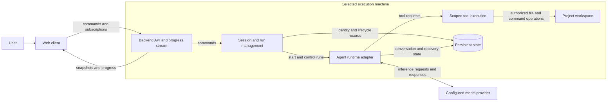

# Console architecture

Status: local provider configuration and multiple Pi Durable sessions are implemented. Opt-in sandboxed file/HTTP tools are implemented; shell execution, conversation forks, and remote access remain planned.

[Requirements](requirements.md) owns product outcomes and scope. This document owns responsibilities,
state, interfaces, and technical tradeoffs. It must distinguish intended design from verified implementation.

## Intended system boundary

Begin with one backend on the machine containing the project workspace and a browser client.
The backend owns execution and saved state. The browser is a view and control surface, not the
owner of the running agent. This separation supports REQ-1 through REQ-5.

The current browser app is served by Next.js. Its health request is forwarded to Fastify
through a Next.js rewrite. These are two local Node.js processes; `mise run dev` starts
both directly on the host. The Next.js process does not own agent execution or persistent sessions.

The machine boundary shows where work and storage belong; it does not require separate services
for each box. The first backend can be one process. Model inference may be remote even when the
backend runs locally; relevant task content and tool results may be sent to that provider.

## Component responsibilities

- **Web client:** workspace/session navigation, task input, progress, errors, and explicit controls.
  It reconnects using stable identities rather than recreating work.
- **Backend API:** validate client requests, expose saved state, and deliver progress. HTTP and an
  event stream are the proposed interface shape; exact routes, payloads, and transport are unresolved.
- **Session/run management:** create identities, bind sessions to approved workspaces, track run
  lifecycle, coordinate limits, and distinguish terminal results from client connectivity.
- **Runtime adapter:** integrate the selected harness without exposing its storage internals to
  clients. Map its events, controls, and recovery behavior into Console's documented contracts.
- **Tool execution:** operate in the selected workspace under configured authority. Concurrent
  code-writing tasks need separate checkouts; a conversation fork is not filesystem isolation.
- **Persistent state:** retain Console metadata and required runtime state. These may be separate
  stores owned by Console and the harness; no shared database schema has been chosen.

## Logical data model

- A backend identifies an execution machine and its capabilities.
- A workspace associates that backend with an approved project directory.
- A session has a stable identity, readable name, workspace, and conversations.
- A conversation retains messages and tool interactions; branching is a later extension.
- A run records an assignment, lifecycle, applicable limits, result, and verification references.
- Later approval records bind a decision to an exact action or artifact, not a reusable blanket permission.

Names aid navigation; stable identities support reopening and request correlation. Entity boundaries,
schemas, event ordering, retention, and compatibility must be settled before implementing their APIs.

## Main flow

1. The client selects a backend and existing workspace and requests a named session.
2. The backend validates the workspace, creates stable identities, and establishes persistent state.
3. A submitted assignment starts a bounded run through the runtime adapter.
4. Runtime and tool activity are recorded and exposed to the client.
5. Disconnecting removes the client connection, not ownership of the run. Reconnection retrieves a
   saved snapshot and the required subsequent activity without resubmitting the assignment.
6. Completion leaves the session available. Cancellation and later archiving/deletion use distinct operations.

Request identity and progress catch-up semantics require explicit design before concurrent clients
or retrying submissions are supported. Do not infer exactly-once execution from this flow.

## Recovery and ownership rules

- A backend process must own a run's execution; multiple clients must not become competing runners.
- Backend restart can recover work only if the selected runtime supports the agreed recovery contract
  and required storage is available. Session history alone does not establish execution recovery.
- Explicit cancellation must survive recovery. An uncertain external effect needs reconciliation or
  an operation identity before a retry can be considered safe.
- Store persistent state and required workspace files independently of disposable runtime instances.
- A worktree isolates source changes, not credentials, network access, ports, or shared databases.
- Client requests, issue text, and tool output do not grant additional execution permissions.

These are intended constraints requiring implementation and proof, not currently enforced guarantees.

## Technology and layout candidates

- **Node.js foundation (configured):** mise provides Node.js (`lts`), pnpm (`latest`), and Biome (`latest`);
  `pnpm-workspace.yaml` discovers packages under `packages/*`. The private root package exposes shared check commands.
  Biome checks JavaScript, TypeScript, JSON, CSS, and GraphQL through pnpm, prek, and CI; RumDL handles Markdown.
  The server uses TypeScript and Fastify in one Node.js process. Its health endpoint, build, type checks,
  and HTTP tests are implemented; see the [server guide](packages/server.md).
- **Web foundation (configured):** Next.js App Router, React, TypeScript, Tailwind CSS, and shadcn/ui provide the browser
  starter. It checks the Fastify health endpoint through a web-origin proxy; see the [web guide](packages/web.md).
  The conversation dashboard and provider settings are implemented; Console user authentication and shared-session controls are not.
  shadcn preset `bddBUJXM` supplies the initial theme, Geist font, and Lucide icon choice.
- **Pi Durable (integrated):** pinned to 1.4.0 for isolated session conversations with opt-in sandboxed tools. Provider authentication and model access use Pi AI. See the integration section below for tested and outstanding behavior.
- **SQLite (integrated):** separate databases hold Console credentials, the session catalog, and per-session Pi-owned conversation state. The first version has no backup or retention workflow; ownership and restart behavior are described below.
- **Monorepo:** `packages/server/` is a private workspace package containing the HTTP server scaffold.
  `packages/web/` is a private Next.js workspace package. These boundaries do not require
  independent microservice deployments.
- **Remote hosting:** a Kubernetes machine was discussed as a later host. It is not required for
  the first local workflow. A central hub, extra clients, and an automation scheduler are not initial components.

Entries marked configured or created describe the repository foundation. Remaining candidates should
not be treated as approved implementation choices solely because they appear here.
The video's Google Cloud, FastAPI, ADK, PostgreSQL, and model choices belong to its example, not Console.

## Developing Console versus Console's runtime

The existing user-level refine-issue and issue-to-pr skills support development of this repository.
They are not shipped Console features and are not required external context sources for understanding
these documents. GitHub issues/PRs track delivery; source and these documents retain durable knowledge.

Future issue, schedule, or event triggers would dispatch through the backend's existing assignment
path. Trigger configuration, deduplication, authority, and approvals need their own concrete designs.

## Implementation evidence and maintenance

Start by selecting one local end-to-end proof from [requirements](requirements.md#acceptance-scenarios-to-refine-into-issues).
Verify the chosen model access and runtime behavior before expanding the product.

Update this document when a change affects ownership, interfaces, storage, lifecycle, or deployment.
Record what is implemented separately from intended design, and replace candidates with the actual
decision and its reasoning when agreed. Keep feature tasks and verification results in their issues/PRs.

## First Pi integration

The [integration decision](decisions/0001-local-pi-integration.md) records provider boundaries. The [session decision](decisions/0002-session-owned-harnesses.md) records isolation, configuration, and preservation of existing data.

- Next.js serves a session sidebar, conversation/composer, and configuration inspector, plus `/settings/providers`. `/api/v1/*` forwards to Fastify `/v1/*`. No separate hub is needed for the current single-machine scope.
- `src/console.ts` registers validated routes, closes resources, and rejects browser mutations without the Console request header. No CORS or Console user authentication is configured. This is for private loopback use only.
- `src/providers.ts` adapts Pi's built-in catalog, login prompts, notifications, cancellation, logout, and explicit model-catalog refresh. Environment-only providers show setup guidance. Provider discovery does not prove access to a model.
- `src/credentials.ts` supplies Pi's credential-store interface. Credentials and installation identity live in `credentials.sqlite`; Pi owns login and token refresh. An exclusive SQLite lock prevents two backend processes from rotating the same credentials.
- `src/sessions.ts` owns a SQLite catalog and one cached harness per session. New sessions store Pi state under `sessions/<uuid>/conversation.sqlite`; an existing root `conversation.sqlite` is registered as the `default` session without moving it. A session that cannot open is listed as unavailable while other sessions remain usable.
- `src/conversation.ts` owns each harness and root conversation. The sandbox extension is registered, with tools disabled until explicitly configured. Configuration, submission, cancellation, and resume are serialized within each session. One run is accepted per session; different sessions have independent execution and transcripts.
- `src/session-routes.ts` exposes session creation, snapshots, saved configuration, and lifecycle commands. Creation request IDs deduplicate retries; message request IDs are scoped to their session.
- Provider responses include supported thinking levels from Pi's `getSupportedThinkingLevels()` and model context capacity. Saving settings validates the selected model/level against the installed catalog and persists them in Pi's `pi.agent` document. Settings changes during unfinished work return 409. Messages use saved settings instead of carrying a second configuration.
- Browser polling retrieves up to 100 recent transcript entries, committed partial text, and lifecycle state. The browser never owns the run. Session list polling runs every two seconds; selected transcript polling runs every second. A URL query remembers selection on reload, and in-memory drafts and uncertain submission IDs remain separate per session while the page is open. Repeated submissions with the same request ID return the original admission, including after restart. A request ID identifies its original input and must not be reused for different content.
- Closing the browser leaves execution running. Backend restart opens saved work without scheduling it; Resume explicitly enables scheduling. Cancel aborts the conversation and persists that outcome. Read tools may replay; file writes and HTTP GET do not replay automatically after interruption. Other external-effect workflows remain unimplemented.

Storage defaults to `$XDG_DATA_HOME/console` or `~/.local/share/console`. `CONSOLE_DATA_DIR` overrides it. The directory is owner-only and saved credentials are plaintext SQLite with owner-only permissions, not an encrypted vault. Keep it outside source control and run one backend per data directory. No automatic retention, export, or backup mechanism exists yet. Login attempts are ephemeral, expire after ten minutes, and can be reattached after a page reload while the backend remains alive.

Pi packages are pinned to 1.4.0. A pnpm patch adds missing JSON import attributes to Pi AI's published declarations, preserving strict NodeNext checking. A package extension supplies the MCP SDK referenced by Google's published declarations. Reviewed Google/protobuf lifecycle scripts are explicitly disabled; neither is required for these installed SDKs to run. Revisit these workarounds on upgrades.

## Configurable tool sandbox

[Decision 0003](decisions/0003-configurable-nono-workers.md) records the process boundary and the CLI choice. Pi retains execution state and model access in Fastify. Tool execution crosses into a fresh `nono wrap` worker for each call.

- `sandbox-policy.ts` defines the saved `console.sandbox` Pi document and validates directory grants. Defaults disable tools, allow no writes, and block network. Enabling requires an existing absolute workspace, which becomes readable. Additional readable and writable directories are explicit; writable grants include reads.
- `sandbox-tools.ts` registers `read_file`, optional `write_file`, and optional `fetch_url`. It reads the saved policy and revalidates grants for every invocation. The model cannot change policy through these tools. No shell or arbitrary JavaScript execution is exposed.
- `sandbox-runner.ts` creates a nono capability manifest inside Console's protected data directory. It supplies a minimal environment, no provider secrets, and fixed read-only prerequisites for Node, the worker/package metadata, system libraries, OpenSSL configuration, and required device files. It executes nono 0.80.0 directly without a shell or inherited profiles.
- `sandbox-worker.ts` runs only after nono installs restrictions and execs Node, so Node's worker threads inherit them. Each call has a ten-second deadline and bounded input/output; text files and HTTP bodies are limited to 64 KiB. Unknown operations/arguments cannot be selected by the model.
- Policies cannot grant Console's private storage or its environment file. Writable grants also exclude the running Console source and Node/nono executable paths. This prevents a tool from rewriting its policy, backend, or launcher. Readable/writable roots are additive; overlapping broad parents are rejected rather than pretending to carve private children out on Linux.
- Policy updates require an idle session, validate paths, and run a restricted startup check before saving an enabled policy. They commit policy and offered tools together. Disabling remains possible even if an old workspace no longer exists. Existing policies are never replaced after a failed activation, and tools never retry outside nono.

Network currently supports blocked or explicitly unrestricted access. Unrestricted includes local services and exposes HTTP GET; domain allowlists and other nono features are not exposed yet. Console account authentication remains deferred, so this is a private single-user application, not a multi-user boundary. Unsupported/missing nono or kernel enforcement fails closed. Native tests exercise filesystem denial, symlink escapes, TCP/UDP denial with positive controls, persisted policies, and real Pi tool invocation on Linux. macOS behavior has not been verified here.
